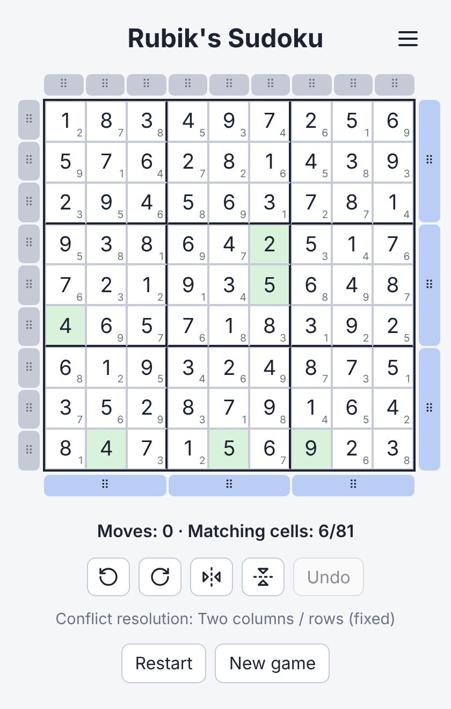
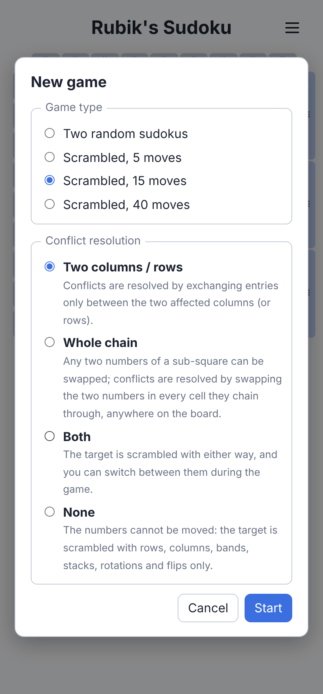

# Rubik's Sudoku

 

Given two random, but already solved sudokus, try to transform the first 
with elementary operations into the second one without ever having an invalid sudoku.

## Allowed operations

- Rotate whole sudoku 90 deg. clock- and counter-clockwise
- Flip whole sudoku horizontally / vertically
- Exchange two whole columns within one column of sub-squares
- Exchange two whole rows within one row of sub-squares
- Exchange two columns of sub-squares
- Exchange two rows of sub-squares
- Exchange two numbers within a sub-square that are in the same row or column
  - Automatically resolving resulting conflicts

## Playing

The numbers in the small corner of each cell show the target sudoku; cells that already match are highlighted.
The game is won when all 81 cells match.

### Game types

"New game" opens a dialog with the available game types:

- **Two random sudokus**: the start and the target are two unrelated solved sudokus.
- **Scrambled (5 / 15 / 40 moves)**: the target is the start sudoku scrambled with that many random moves, so it is
  always reachable.

### Conflict resolution

Swapping two numbers within a sub-square can create conflicts, which are resolved automatically in one of two ways:

- **Two columns / rows**: only entries between the two affected columns (or rows) are exchanged.
- **Whole chain**: the two numbers are swapped in every cell they chain through, anywhere on the board.

For scrambled games there are two more options:

- **Both**: the target is scrambled with either way and you can switch between them during the game.
- **None**: numbers cannot be moved at all; the target is scrambled only with rows, columns, bands, stacks,
  rotations and flips.

For random games the way can be switched with the button below the controls. For scrambled games with a fixed way, a
mode indicator shows which one is in use.

### Other

- Restart and New game ask for confirmation if the current game is in progress.
- The last chosen game type and way are saved in the browser.
- The menu in the corner opens the Help page (how to play, the moves, the conflict resolution) and the About page
  (links to the sources and the author).
